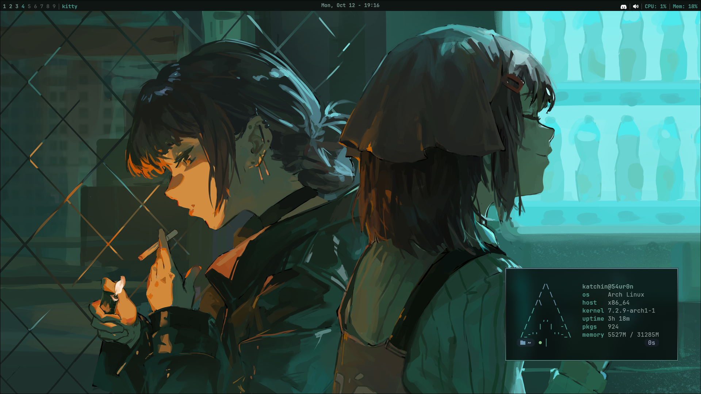

# **Dotfiles - Hyprland**

Personal dotfiles for an Arch Linux desktop built around Hyprland. Old configs can be found in the [legacy branch](https://github.com/Davi-K-Silva/dotfiles/tree/legacy)

## Main directories

- `config-in-dot/` contains configurations that belong in `~/.config/`.
- `config-out-dot/` contains configurations that belong directly in the home directory (`~/`).

## Note

For now, the bar system and wallpaper color setup are maintained in private repositories and are not included here.

## Next steps

- Release the bar system and wallpaper color repositories.
- Create bidirectional sync scripts to keep these dotfiles and `~/.config/` up to date.
