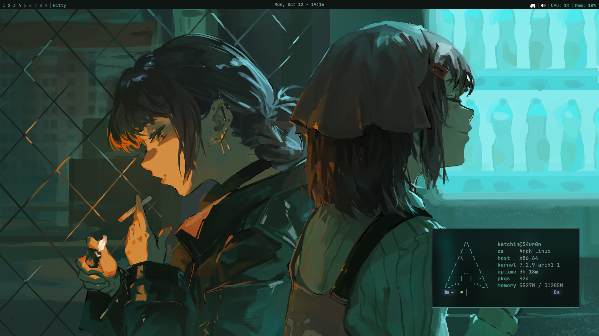

# **Dotfiles - Hyprland**

Personal dotfiles for an Arch Linux desktop built around Hyprland. Old configs can be found in the [legacy branch](https://github.com/Davi-K-Silva/dotfiles/tree/legacy)



## Main directories

- `config-in-dot/` contains configurations that belong in `~/.config/`.
- `config-out-dot/` contains configurations that belong directly in the home directory (`~/`).

## Note

For now, the bar system and wallpaper color setup are maintained in private repositories and are not included here.

## Syncing configs

Standalone Bash script; requires Linux, Bash 4.4+, GNU coreutils, and `flock`
(from util-linux). 
Run from any directory:

```sh
./sync.sh to-home --dry-run             # Preview repo -> installed configs
./sync.sh to-home                       # Install managed configs
./sync.sh to-repo                       # Collect installed configs into this repo

./sync.sh to-home --only config-in-dot/kitty
./sync.sh to-repo --only config-out-dot/.zshrc
./sync.sh to-home --exclude config-in-dot/hypr
./sync.sh to-repo --exclude 'config-in-dot/hypr/*.log'

./sync.sh --revert --dry-run             # Preview undo
./sync.sh --revert                       # Undo the latest sync
./sync.sh --revert                       # Undo the preceding sync
```

`--only` and `--exclude` can be repeated. Paths are relative to this repo, not
your current directory; quote exclusion globs. Selecting a directory includes
its descendants. Exclusions take precedence over selections.

- `config-in-dot/` maps to `~/.config/`; `config-out-dot/` maps to `~/`.
- **Exception:** `config-out-dot/pacman.conf` maps to `/etc/pacman.conf`.
  It is skipped during bulk syncs, even when selecting `config-out-dot`.
  Select it explicitly with `--only config-out-dot/pacman.conf`. Writing it
  requests `sudo` permission when needed; do not run the whole script with sudo.
- Bulk syncs only visit top-level entries already managed in the repo. To add
  an entirely new app, first create its entry under the appropriate repo directory.
  Syncing a managed directory collects new files within it too.
- New/changed files are copied, **never destination-only files deleted**. Missing
  sources are skipped in bulk syncs and reported as errors with `--only`.
- `config-in-dot/hypr/tmp/` and `config-in-dot/hypr/hyprlock-bkg/` are always
  excluded. Other `.gitignore` rules are not automatically sync exclusions.
- Symlinks are copied as symlinks; writing through symlinked parent directories
  and replacing conflicting file types is refused. File permissions are preserved;
  ownership and existing directory permissions are not changed.

### Backups and undo

The last **two syncs that changed files**, shared across both directions, are
saved in the gitignored `.backup/` directory (owner-only access). Dry runs and
no-op syncs do not consume undo levels. Backups may contain sensitive settings;
they are local undo history, not a substitute for external backups.

Undo restores overwritten files and removes files/empty directories created by
that operation. It refuses to overwrite subsequent edits or remove directories
containing new files. Resolve those conflicts before retrying; no undo slot is
consumed on a conflict. There is no force-revert option or redo.

Failed syncs attempt to roll back automatically. After an interrupted operation,
run `./sync.sh --revert` to recover before syncing again. Backups record absolute
destination paths, so keep this checkout and home directory in place while using
its undo history. Avoid editing configs concurrently with sync or undo.

Run the isolated tests (they do not touch your installed configs):

```sh
bash tests/test_sync.sh
```

## Next steps

- Release the bar system and wallpaper color repositories.
