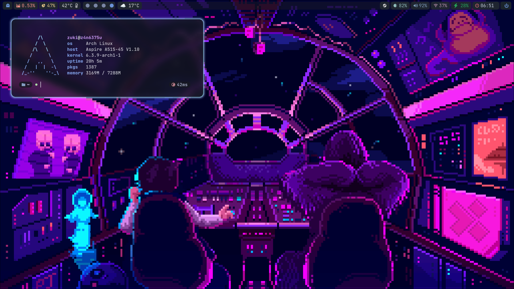
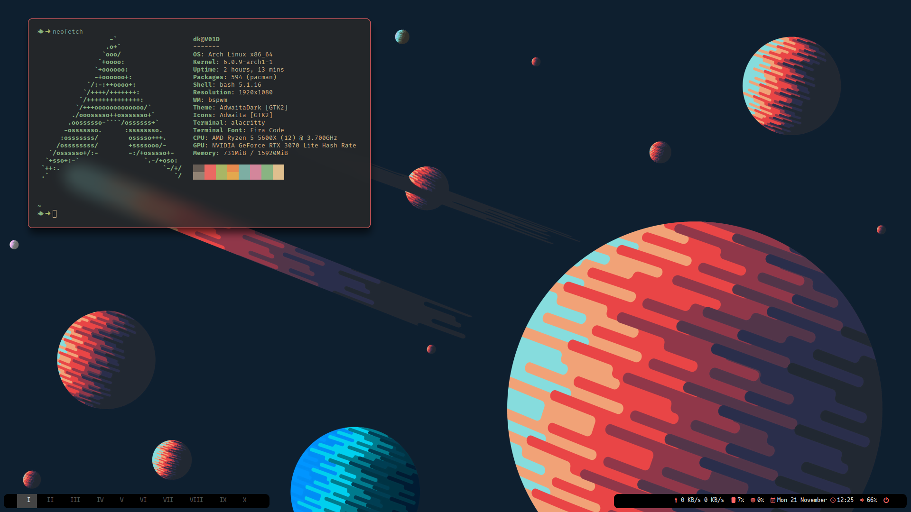
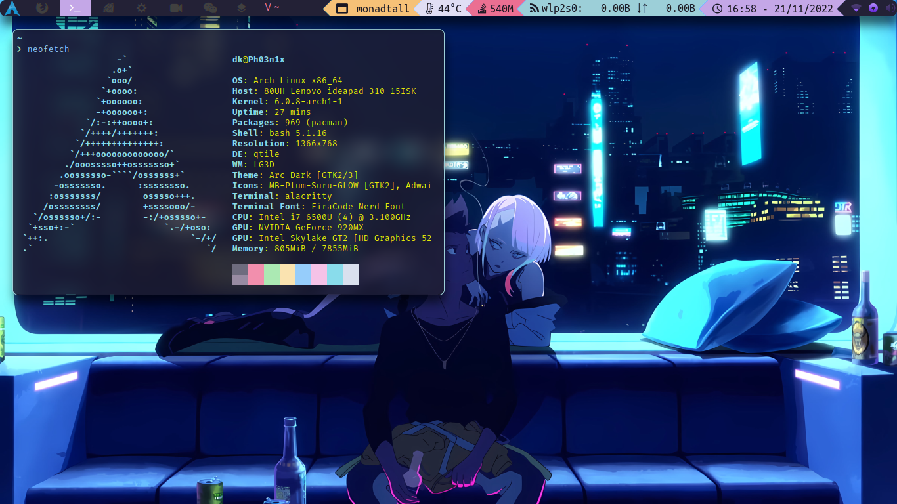

# **Dotfiles**

These are the config files I'm using in my environments.
I plan to upgrade this repo with original scripts and configs, since it is currently just a Frankenstein's monster of other people's code.

My Wayland configs are based on [1amSimp1e](https://github.com/1amSimp1e/)'s files; you can see them [here](https://github.com/1amSimp1e/dots).
I based almost all of my old configs on those from [Jorgeloopz](https://github.com/jorgeloopzz). He has good taste and organizes his configs well. I really recommend [checking them out](https://github.com/jorgeloopzz/dotfiles).

### **Disclaimer**:
First of all, this repo is far from complete, so be aware that my workarounds and minor differences are not here. Use it wisely and be patient with the installation if you are going to do it.

I used the X display server in my old setups because NVIDIA can be very stubborn with Wayland. That was until my laptop and PC were stolen. Since then, I have gotten a new laptop with AMD graphics, which allowed me to use Wayland. That's why my [old setups](https://github.com/Davi-K-Silva/dotfiles/tree/old_dots) and configs have different settings and programs.

---

## **Programs List**
- Distribution: [Arch Linux](https://wiki.archlinux.org/)												
- Window Manager: [Hyprland](https://hyprland.org/)
- Status bar: [Waybar](https://github.com/Alexays/Waybar)
- Terminal emulators: [Kitty](https://wiki.archlinux.org/title/Kitty), [Alacritty](https://wiki.archlinux.org/title/Alacritty)										
- Shell: [oh-my-zsh](https://ohmyz.sh/)													
- Prompt: [Starship](https://starship.rs/)													
- Browsers: [Firefox](https://www.mozilla.org/en-US/firefox/new/)											
- IDEs: [VS Code](https://wiki.archlinux.org/title/Visual_Studio_Code)
- Video/Audio player: [MPV](https://wiki.archlinux.org/title/Mpv)												
- Music player: [Spotify](https://wiki.archlinux.org/title/Spotify)											
- Background setter: [swww](https://github.com/Horus645/swww)																				
- Launchers: [Rofi](https://wiki.archlinux.org/title/Rofi) 																					
- Screen recorder: [OBS](https://wiki.archlinux.org/title/Open_Broadcaster_Software)			
- Notifications: [Dunst](https://wiki.archlinux.org/title/Dunst)											
- Sound: [Pulseaudio](https://wiki.archlinux.org/title/PulseAudio), [Pavucontrol](https://github.com/pulseaudio/pavucontrol) (GUI)
- Network: [Network manager](https://wiki.archlinux.org/title/NetworkManager)																																		
- Fonts: FiraCode, mononoki, SpaceMono, UbuntuMono

## **Screenshots**

### [Hyprland](https://github.com/Davi-K-Silva/dotfiles/tree/main/.config/hypr)

### [bspwm [OLD]](https://github.com/Davi-K-Silva/dotfiles/tree/old_dots/.config/bspwm)

### [qtile [OLD]](https://github.com/Davi-K-Silva/dotfiles/tree/old_dots/.config/qtile)

